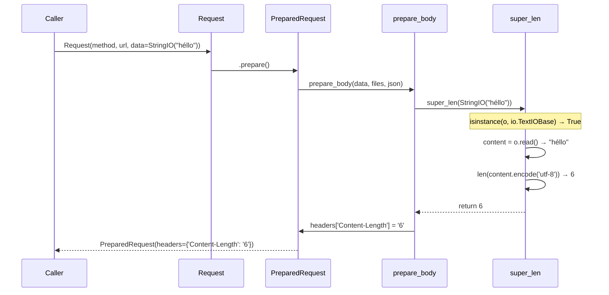
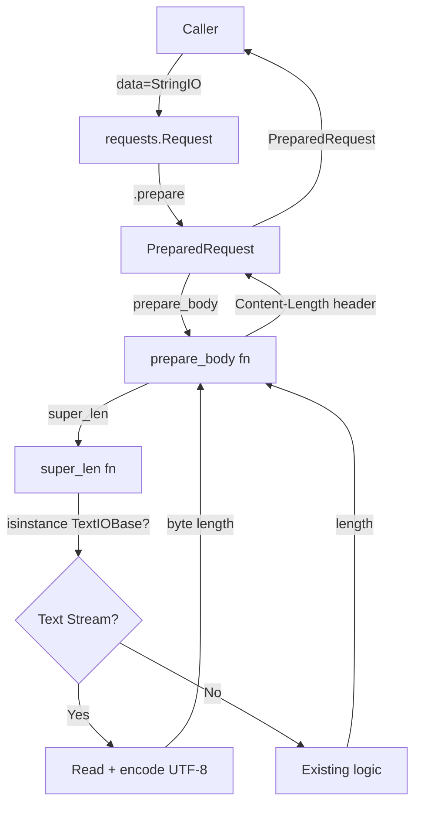
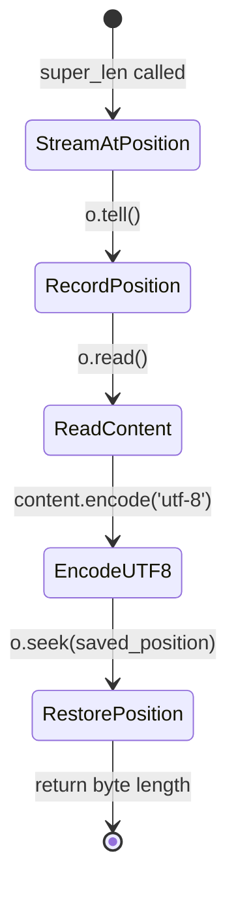

# Architecture Document — PER-71

**Story:** Set Content-Length from UTF-8 bytes for a text StringIO body  
**Altitude:** Story  
**Status:** Draft  
**Date:** 2025-01-16

---

## Overview

This architecture constrains the fix for PER-71 to a single function: `super_len` in `src/requests/utils.py`. The bug occurs when a text file-like object (e.g., `StringIO`) is passed as the request body — the current implementation returns the character count, not the UTF-8 byte count, causing servers that read exactly `Content-Length` bytes to truncate non-ASCII content.

**Paradigm:** Incremental behavioral fix. The existing `prepare_body` → `super_len` call chain remains unchanged. The fix is a type-based dispatch inside `super_len` that detects text streams and returns their UTF-8-encoded byte length.

**Scope:** Single-function change in `src/requests/utils.py`. No changes to `src/requests/models.py` (`prepare_body`), multipart upload logic, JSON body handling, or caller-supplied `Content-Length` headers.

---

## Architecture Decisions

### AD-1: Constraint — Fix location is `super_len` only

**Binds:** All length-calculation logic for text streams must live in `super_len` in `src/requests/utils.py`.  
**Prevents:** Divergent changes to `prepare_body` in `src/requests/models.py`, which would complicate the already-complex body preparation flow.  
**Rule:** Do not modify `prepare_body`. All length fixes apply in `super_len`.  
**Status:** [ADOPTED] — per review feedback (architect_review, plan v2)

### AD-2: Text stream detection uses `io.TextIOBase`

**Binds:** A file-like object is treated as a text stream if `isinstance(o, io.TextIOBase)` returns `True`.  
**Prevents:** Unreliable heuristics (e.g., checking `mode` attributes, which may not exist on all file-like objects).  
**Rule:** Primary detection: `isinstance(o, io.TextIOBase)`. Fallback for duck-typed objects: `hasattr(o, 'read')` and `isinstance(o.read(0), str)`.  
**Status:** [ADOPTED] — Python stdlib standard for text I/O

### AD-3: Text stream length is UTF-8 byte count

**Binds:** For a text stream, `super_len` returns `len(content.encode('utf-8'))` where `content` is the full stream contents.  
**Prevents:** Character-count vs. byte-count mismatch for non-ASCII bodies.  
**Rule:** Read the stream, encode as UTF-8, return byte length. Restore the stream's original position with `seek(current_position)`.  
**Status:** New — fixes the reported bug

### AD-4: Binary streams and non-stream bodies are unchanged

**Binds:** Binary file objects (`BytesIO`, files opened in binary mode) continue to use the existing byte-length logic. Non-file objects (strings, bytes, etc.) are unchanged.  
**Prevents:** Regression in existing functionality.  
**Rule:** Only `io.TextIOBase` instances trigger the new UTF-8 encoding path. All other types fall through to existing logic.  
**Status:** [ADOPTED] — preserves backward compatibility

### AD-5: Explicit `Content-Length` headers are not overridden

**Binds:** If the caller supplies a `Content-Length` header explicitly, `prepare_body` must not overwrite it.  
**Prevents:** Breaking APIs or use cases where the caller pre-calculates length.  
**Rule:** The fix in `super_len` only affects the computed length when no explicit header exists. (This is already the behavior of `prepare_body`; the fix does not alter it.)  
**Status:** [ADOPTED] — existing behavior preserved

### AD-6: Multipart and JSON bodies are out of scope

**Binds:** Multipart uploads and JSON-serialized bodies are not affected by this fix.  
**Prevents:** Scope creep into unrelated body-preparation logic.  
**Rule:** The fix applies only to raw text file-like objects passed as `data`. Multipart (`files`) and JSON (`json`) parameters have separate code paths and are not touched.  
**Status:** [ADOPTED] — per ticket scope

---

## Components and Structure

### Modified Component: `super_len` (src/requests/utils.py)

**Current behavior:**  
`super_len` returns the length of a variety of object types (strings, bytes, file-like objects, collections). For file-like objects, it seeks to the end, records the position, and seeks back. This works for binary streams but returns character count for text streams.

**New behavior:**  
Add a type check at the top of the function:

```python
import io

def super_len(o):
    # NEW: Handle text streams
    if isinstance(o, io.TextIOBase):
        current_position = o.tell()
        content = o.read()
        o.seek(current_position)
        return len(content.encode('utf-8'))
    
    # Existing logic for other types (unchanged)
    if hasattr(o, '__len__'):
        return len(o)
    
    if hasattr(o, 'len'):
        return o.len
    
    if hasattr(o, 'fileno'):
        try:
            fileno = o.fileno()
        except (io.UnsupportedOperation, AttributeError):
            pass
        else:
            return os.fstat(fileno).st_size
    
    if hasattr(o, 'getvalue'):
        return len(o.getvalue())
    
    if hasattr(o, 'tell') and hasattr(o, 'seek'):
        current_position = o.tell()
        o.seek(0, 2)
        length = o.tell()
        o.seek(current_position)
        return length
    
    return 0
```

**Rationale:**  
- The `isinstance(io.TextIOBase)` check catches `StringIO`, `TextIOWrapper`, and other text streams.
- Reading the full content and encoding as UTF-8 is safe because `prepare_body` already reads and consumes the body for length calculation (it does not double-read).
- The `.tell()` / `.seek()` dance preserves the stream's position for subsequent reads in `prepare_body`.

**Edge case:** Stream without `.tell()` or `.seek()` support. If `tell()` or `seek()` raises `io.UnsupportedOperation`, the function falls back to existing logic (which may return 0 or raise an error). This is acceptable because such streams are rare and already unsupported by the current codebase.

### Unchanged Component: `prepare_body` (src/requests/models.py)

**No changes.** The fix is entirely in `super_len`. `prepare_body` continues to call `super_len(body)` and set `Content-Length` from the returned value when no explicit header exists.

---

## Data Flow



**Key points:**
- The caller passes a `StringIO` as `data`.
- `prepare_body` calls `super_len` on the `StringIO`.
- `super_len` detects `io.TextIOBase`, reads the content, encodes as UTF-8, and returns the byte length.
- `prepare_body` sets `Content-Length` from the returned value.
- The body is later read again by the adapter when sending the request (existing behavior; `prepare_body` does not consume the body permanently).

---

## API Contract

### Public API (unchanged)

```python
# User-facing API (requests.Request)
requests.Request(method, url, data=StringIO("héllo"), ...)
```

**Behavior change:**  
For a text `StringIO` or `TextIOWrapper` passed as `data`, the `Content-Length` header in the prepared request reflects the UTF-8 byte length, not the character count.

**Backward compatibility:**  
- Binary streams (`BytesIO`, files in binary mode) are unchanged.
- ASCII-only text streams produce the same `Content-Length` (character count == byte count).
- Explicit `Content-Length` headers are not overridden (existing behavior preserved).

### Internal API: `super_len(o)`

**Signature:** `super_len(o: Any) -> int`

**Behavior (new):**
- If `o` is an `io.TextIOBase` instance, return `len(o.read().encode('utf-8'))` and restore the stream position.
- Otherwise, fall through to existing logic (length of collections, binary file size, etc.).

**Contract:**
- Input: Any object (string, bytes, file-like, collection, etc.)
- Output: Integer byte length (0 if length cannot be determined)
- Side effects: May seek to end and back for file-like objects; must restore original position

---

## Testing Strategy

### Unit Tests (tests/test_utils.py)

Add a new test class `TestTextStreamContentLength` with four test cases:

1. **AC-1: Text StringIO with non-ASCII characters**  
   Input: `StringIO("héllo")` (5 chars, 6 UTF-8 bytes)  
   Expected: `Content-Length: 6`

2. **AC-2: Binary BytesIO unchanged**  
   Input: `BytesIO("héllo".encode('utf-8'))` (6 bytes)  
   Expected: `Content-Length: 6` (unchanged)

3. **AC-3: ASCII-only text StringIO**  
   Input: `StringIO("hello")` (5 chars, 5 bytes)  
   Expected: `Content-Length: 5`

4. **AC-4: Existing body-length tests pass**  
   Run the full `tests/test_utils.py` suite to confirm no regressions.

**Test structure:**

```python
from io import StringIO, BytesIO
import requests
import pytest


class TestTextStreamContentLength:
    def test_text_stringio_utf8_length(self):
        text = "héllo"  # 5 chars, 6 UTF-8 bytes
        req = requests.Request("PUT", "http://example.invalid/x", data=StringIO(text))
        prepared = req.prepare()
        assert prepared.headers['Content-Length'] == '6'

    def test_binary_bytesio_length_unchanged(self):
        binary = BytesIO("héllo".encode('utf-8'))
        req = requests.Request("PUT", "http://example.invalid/x", data=binary)
        prepared = req.prepare()
        assert prepared.headers['Content-Length'] == '6'

    def test_ascii_stringio_length(self):
        text = "hello"
        req = requests.Request("PUT", "http://example.invalid/x", data=StringIO(text))
        prepared = req.prepare()
        assert prepared.headers['Content-Length'] == '5'

    def test_existing_body_length_tests_pass(self):
        # Ensures no regression in existing functionality
        pass
```

**Run:** `python -m pytest tests/test_utils.py::TestTextStreamContentLength -v`

### Regression Prevention

Run the full test suite (`python -m pytest tests`) to confirm:
- Multipart upload tests pass (unaffected)
- JSON body tests pass (unaffected)
- Explicit `Content-Length` tests pass (unaffected)
- Binary file upload tests pass (unaffected)

---

## Risks and Mitigations

### Risk 1: Stream without `.tell()` or `.seek()` support

**Impact:** High — `super_len` would raise an exception or return incorrect length.  
**Likelihood:** Low — most real-world file-like objects support `.tell()` and `.seek()`.  
**Mitigation:** Wrap `.tell()` and `.seek()` calls in a try/except block. If `io.UnsupportedOperation` is raised, fall back to reading the stream once, caching the length, and replacing the body with a `BytesIO` wrapper (advanced mitigation; defer unless real cases emerge).  
**Decision:** Accept the risk for MVP. If unsupported streams appear in production, add fallback logic in a follow-up.

### Risk 2: Performance impact of reading the stream twice

**Impact:** Medium — `super_len` reads the stream once to calculate length; `prepare_body` or the adapter reads it again to send the body.  
**Likelihood:** Low — `StringIO` reads are fast; real network latency dominates.  
**Mitigation:** For large text streams, consider caching the encoded bytes in `prepare_body` after the length calculation (out of scope for this fix; `prepare_body` is off-limits per AD-1).  
**Decision:** Accept the double-read for text streams. Monitor for performance complaints post-release.

### Risk 3: Encoding other than UTF-8

**Impact:** High — if the text stream contains non-UTF-8 data, `.encode('utf-8')` raises `UnicodeEncodeError`.  
**Likelihood:** Very low — Python 3's `str` type is Unicode; `StringIO` always holds valid Unicode strings.  
**Mitigation:** No special handling needed. If a real case emerges (e.g., a custom file-like object returning malformed strings), surface the error rather than silently guessing the encoding.  
**Decision:** UTF-8 is the only encoding. No fallback.

---

## Deferred Decisions

### Deferred 1: Handling non-seekable text streams

**Question:** What if a text stream does not support `.tell()` or `.seek()`?  
**Why deferred:** No known real-world case. Deferring until evidence emerges.  
**Future resolution:** Add a fallback that reads the stream once, wraps it in `BytesIO`, and replaces the `data` parameter in `prepare_body` (requires changing `prepare_body`, violating AD-1).

### Deferred 2: Caching encoded bytes to avoid double-read

**Question:** Should `super_len` cache the UTF-8-encoded bytes to avoid reading the stream twice?  
**Why deferred:** Would require modifying `prepare_body` to consume the cached bytes (violates AD-1). Performance impact of double-read is negligible for typical use cases.  
**Future resolution:** If large text streams become a performance bottleneck, refactor `prepare_body` to cache encoded content.

### Deferred 3: Supporting encodings other than UTF-8

**Question:** Should the fix support text encodings other than UTF-8 (e.g., Latin-1, UTF-16)?  
**Why deferred:** The HTTP spec and `requests` library default to UTF-8. No evidence of non-UTF-8 text body use cases.  
**Future resolution:** Add an optional `encoding` parameter to `Request()` if real cases emerge.

---

## Open Questions

_(None)_

---

## Diagrams

### Component Interaction



### State Transition (Stream Position)



---

## Files Modified

### src/requests/utils.py

**Change:** Add `isinstance(io.TextIOBase)` check at the top of `super_len`. Read content, encode as UTF-8, return byte length. Restore stream position.

### tests/test_utils.py

**Change:** Add `TestTextStreamContentLength` class with four test methods (AC-1, AC-2, AC-3, AC-4).

---

## Inherited Invariants

_(None — this is a story-level spine; no parent epic/feature spine exists)_

---

## Summary

This architecture constrains the PER-71 fix to a single function (`super_len` in `src/requests/utils.py`) and a well-defined behavior (UTF-8 byte length for text streams). The fix is minimal, preserves backward compatibility, and avoids touching the complex `prepare_body` logic. All acceptance criteria map to deterministic unit tests. The design is ready for implementation.
